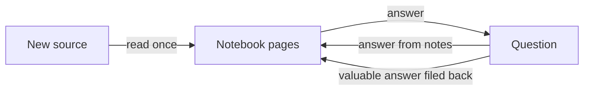
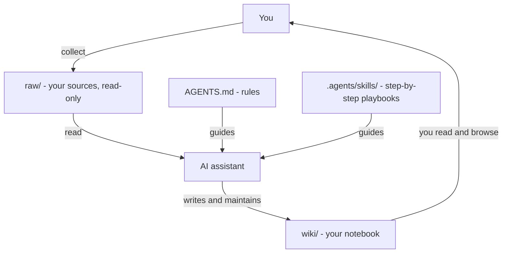
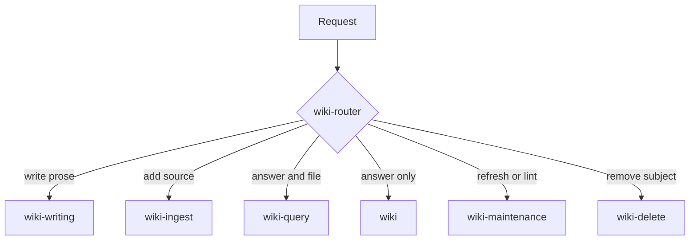
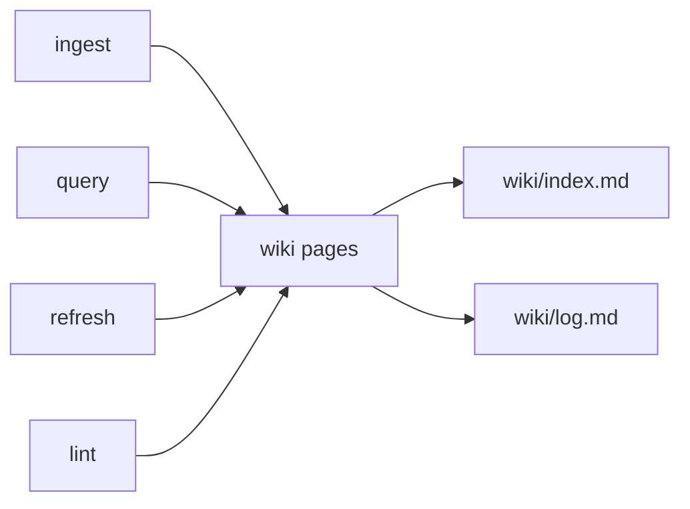

# LLM Wiki

**A living notebook that an AI assistant writes and keeps up to date for you — a persistent, compounding alternative to RAG for developers using Claude Code, Cursor, GitHub Copilot, OpenCode, or Codex.**

You save articles, papers, notes, and data files. The assistant reads each one once, writes down what it learned, links related ideas, and keeps the notes current when new material arrives. Instead of searching through files every time you ask a question, it answers from notes it has already organized.

This project is a template for that workflow. It follows the idea described in Andrej Karpathy's [LLM Wiki gist](https://gist.github.com/karpathy/442a6bf555914893e9891c11519de94f).

---

## Why this is different

Most AI tools that work with documents use retrieval. You upload files, and at question time the model pulls the relevant pieces and writes an answer from them. That works, but the model starts over on every question. Nothing accumulates, and a subtle question that spans several documents means reassembling the same fragments again.

An LLM wiki works the other way. The model reads each source once and writes what it learned into a folder of linked markdown pages. It updates topic pages, revises summaries, flags where new material contradicts older claims, and keeps a running synthesis. Knowledge is compiled once and then kept current, instead of being rebuilt on every query.

The result is a persistent, compounding artifact: cross-references already exist, contradictions are already flagged, and each source you add or question you ask makes the notebook richer.



## How it works in plain terms

There are three layers between you and your sources:

- `raw/` holds the documents you collect: articles, papers, images, and data files. These are **read-only**. The assistant reads them but never changes them.
- `wiki/` holds the markdown pages the assistant owns: one page per source, plus pages for people, organizations, ideas, methods, comparisons, and durable answers.
- `AGENTS.md` is the rulebook. It tells the assistant how the notebook is structured, what the conventions are, and what to do when adding a source, answering a question, or checking the notebook for problems.



You rarely write the notebook yourself. You curate sources, explore, and ask questions; the assistant does the summarizing, cross-referencing, filing, and bookkeeping. Many people keep the assistant on one side of the screen and a markdown browser such as Obsidian on the other, watching the pages update as the assistant edits.

## What you do vs. what the assistant does

| You | The assistant |
|---|---|
| Collect and save source material into `raw/` | Reads each source and writes a summary page |
| Ask questions and explore | Answers from the notebook and links related pages |
| Decide what matters | Updates entity, concept, and synthesis pages |
| Review the result | Flags contradictions and keeps the index and log current |

## Quick start (60 seconds)

```bash
git clone https://github.com/jonyfs/llm-wiki-template.git my-notebook
cd my-notebook
python3 -m unittest discover -s tests -t .   # sanity check
python3 scripts/lint.py                        # empty notebook, should pass
```

Then ask your assistant: "Ingest the file I just added to `raw/`." Watch `wiki/` populate.

## Getting started

1. **Add sources.** Put articles, papers, notes, or data files into `raw/`.
2. **Ask the assistant to ingest them.** It creates or updates pages in `wiki/`.
3. **Browse the notebook.** Open `wiki/index.md` to see the catalog and learning paths.
4. **Ask questions.** The assistant answers from the notebook and can file durable answers as new pages.
5. **Check health.** Run lint and refresh to find stale claims, broken links, and missing pages.

If you are new to the template, ask the assistant to walk you through a first source end to end.

## Folder map

```
.
├── AGENTS.md                 # always-on rules for structure and workflows
├── .agents/
│   ├── skills/               # step-by-step playbooks for each task
│   └── commands/             # short commands that invoke the playbooks
├── raw/                      # your curated, read-only source documents
├── wiki/                     # the assistant-maintained notebook
│   ├── index.md              # catalog of pages and learning paths
│   ├── log.md                # append-only record of operations
│   ├── sources/              # one page per source (optional subject subfolder)
│   ├── entities/             # people, organizations, products, places
│   ├── concepts/             # ideas, methods, theories
│   └── syntheses/            # comparisons, maps, durable answers
├── scripts/                  # helpers for lint, refresh, and search
├── tests/                    # checks that keep the template healthy
└── docs/                     # migration notes for derived notebooks
```

Multi-agent entry points (`CLAUDE.md`, `.cursorrules`, `.github/copilot-instructions.md`, `.claude/`, `.opencode/`) are links to the same source of truth, so one edit reaches every assistant.

## Skills and commands

The assistant loads a playbook before doing substantive work. Each playbook is a folder under `.agents/skills/` with a `SKILL.md` file.

| Playbook | What it does |
|---|---|
| `wiki-writing` | Create or revise notebook prose for any page type, with templates and citation rules. |
| `wiki-ingest` | Integrate curated material from `raw/` into `wiki/` and update related pages, index, and log. |
| `wiki-query` | Answer from the notebook first, then file durable answers back as synthesis pages. |
| `wiki` | Answer from the notebook in read-only mode, without changing any file. |
| `wiki-maintenance` | Refresh source drift and run lint and health checks. |
| `wiki-delete` | Remove a subject, page, or reference safely, with impact review and confirmation. |
| `wiki-router` | Map an unclear request to exactly one of the playbooks above. |

Short commands in `.agents/commands/` invoke the matching playbook:

| Command | Playbook | Use |
|---|---|---|
| `/wiki-ingest` | `wiki-ingest` | Ingest curated source material. |
| `/wiki-query` | `wiki-query` | Answer a question and possibly file it. |
| `/wiki` | `wiki` | Read-only answer. |
| `/wiki-refresh` | `wiki-maintenance` | Run a refresh pass. |
| `/wiki-lint` | `wiki-maintenance` | Run a lint and health check. |



## Everyday workflow

1. Add curated source material to `raw/`.
2. Follow `AGENTS.md` for the always-on contract and load the relevant playbooks from `.agents/skills/`.
3. Create or update pages in `wiki/sources/`, `wiki/entities/`, `wiki/concepts/`, and `wiki/syntheses/`.
4. Use synthesis pages for reusable questions, comparisons, and topic maps.
5. Keep `wiki/index.md`, learning paths, and `wiki/log.md` up to date.



## Keeping the notebook healthy

- **refresh** detects when a source has changed and reports which pages should be revisited. Run with `python3 scripts/refresh.py`.
- **lint** checks structure, link integrity, stale claims, and integration gaps. Run with `python3 scripts/lint.py`.
- **search** finds pages by term. Run with `python3 scripts/wiki_search.py "<terms>"`.

## Validation

- Run the test suite: `python3 -m unittest discover -s tests -t .`
- Run lint on a notebook: `python3 scripts/lint.py`
- Run refresh on a notebook: `python3 scripts/refresh.py`
- Search a notebook: `python3 scripts/wiki_search.py "<terms>"`

## LLM wiki vs. RAG vs. plain notes

| Approach | How it answers | What accumulates | Best for |
|---|---|---|---|
| **LLM wiki (this template)** | From already-organized notes | Cross-references, contradictions, synthesis | Personal/team knowledge that compounds |
| RAG / vector search | Reassembles fragments per question | Nothing; starts over each time | Large, fast-changing corpora |
| Plain notes | You search and read | Whatever you manually write | Small, ad-hoc collections |

## Compatibility

| Harness | Entry point | Status |
|---|---|---|
| Claude Code | `CLAUDE.md` -> `AGENTS.md` | Supported |
| Cursor / OpenCode | `.cursorrules` -> `AGENTS.md` | Supported |
| GitHub Copilot | `.github/copilot-instructions.md` -> `AGENTS.md` | Supported |
| Codex | `.agents/skills/` | Supported |

Python 3.9+ on macOS, Linux, and Windows. Standard library only.

## Frequently asked questions

- **Why not RAG?** RAG reassembles fragments on every question; nothing accumulates. This template compiles knowledge once and keeps it current.
- **Does it cost a lot of tokens?** `AGENTS.md` is under 8 KB and scripts print one-line summaries by default.
- **Is my data sent anywhere?** No. Scripts are stdlib-only with no network calls; raw/ stays local.
- **Does it work offline?** Yes, for everything except optional web ingestion.
- **Am I locked to one model?** No. The contract is plain markdown plus Python; any agent that reads files works.

## Showcase

Built something with this template? Open a Discussion ("Show and tell") and it may be linked here.

## Status

Actively maintained. Last reviewed: 2026-10-26. CI runs on every push and pull request.

## Get started

Click **"Use this template"** on GitHub, then follow the [Quick start](#quick-start-60-seconds) above.

## Advanced notes

- Subject subfolders: each content directory may contain one optional level of subject subfolders, such as `wiki/sources/physics/`. This keeps large notebooks from accumulating hundreds of files in one folder.
- Claims ledger: source pages may include an optional `## Claims ledger` section for claims that other pages cite precisely.
- Multi-agent support: all agent entry points are links to the same source of truth, so changes propagate consistently.

## Credits

This template began from [caelaxie/llm-wiki-template](https://github.com/caelaxie/llm-wiki-template), which laid the foundation for the `raw/ -> wiki/` model this repo builds on. The underlying idea comes from Andrej Karpathy's [LLM Wiki gist](https://gist.github.com/karpathy/442a6bf555914893e9891c11519de94f).
